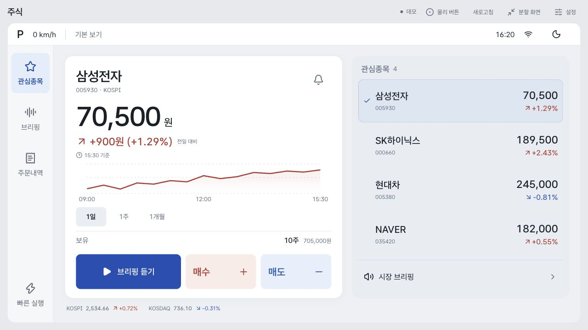

# 차량용 주식 앱

차량 화면에서 관심종목을 조회하고 시세 브리핑과 모의 주문을 조작하는 프로토타입입니다. 현대자동차그룹 차량용 앱 개발 공모전 출품 준비물입니다.



## 실행

Node.js 24가 필요합니다. 저장소 루트에서 실행합니다.

```sh
cd prototype
npm ci
npm run dev
```

브라우저에서 `http://127.0.0.1:4174`를 엽니다. 기본 모드는 API 키 없이 예시 시세와 모의 주문을 사용합니다.

Android는 [서명된 release APK](apk/개인_주식_release.apk)를 설치하거나 [빌드 안내](android/README.md)에 따라 직접 빌드할 수 있습니다. APK는 예시 데이터로 동작하며 증권사 서버에 연결하지 않습니다.

검증 환경은 일반 Android API 36 에뮬레이터와 1280×720·1024×600·400×844 브라우저 화면입니다. Pleos Connect 에뮬레이터는 아직 사용하지 않았으며 해당 버전·화면 규격의 실행 검증은 남아 있습니다.

## 구현한 기능

- 관심종목 현재가·보유 수량, 차트, 시세 브리핑과 브라우저 음성 읽기
- 매수·매도 수량 입력, 모의 주문 접수·체결·취소와 주문내역
- 방향키·회전·선택·뒤로 입력, 수량 편집, 팝업 종료 후 초점 복귀
- 주간·야간·분할 화면, 차량 상태와 UX 제한 시뮬레이션
- 한국투자증권·키움 모의투자 API 연결 코드와 로컬 서버

증권사 연결은 브라우저에서 별도 설정합니다. 실제 키를 사용한 인증·조회·주문은 아직 검증하지 않았습니다. 차량 상태는 시뮬레이션이며 Pleos SDK·실차 연결도 남아 있습니다.

## 살펴보기

| 자료 | 내용 |
| --- | --- |
| [데모 사용법](docs/demo-guide.md) | 종목 조회, 주문, 브리핑, 물리 입력 조작 순서 |
| [구조와 API 대응](docs/architecture.md) | 브라우저·서버·Android 구성과 Pleos 연결 범위 |
| [증권사 설정](prototype/BROKER-INTEGRATION.md) | 모의투자 키 설정, 주문 상태, HTTP 경로 |
| [검증 결과](docs/validation.md) | 자동 테스트·빌드와 브라우저·에뮬레이터 확인 범위 |
| [APK 정보](artifacts/README.md) | 설치 명령, 빌드 환경, 파일 해시 |

2026-11-15 기준 앱 테스트 118개, Android 검증 도구 테스트 9개와 웹·debug·release 빌드와 release 서명·설치를 확인했습니다. 이 저장소는 개발 중간 결과물이며 공모전 접수·실차 검증·release APK 제출 완료를 뜻하지 않습니다.
