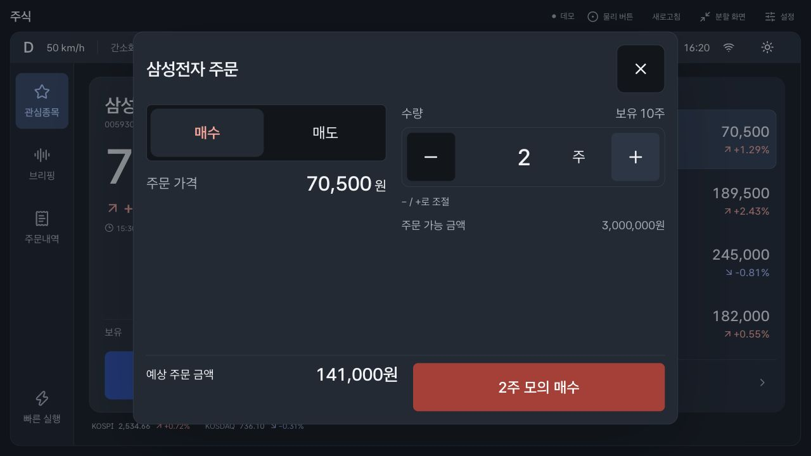

# 데모 사용법

기본 `demo` 모드는 고정 시세와 현금 3,000,000원을 사용합니다. 브라우저 페이지를 새로고침하면 데모 주문과 설정을 초기화합니다. 아래의 주문은 실제 증권사로 전송하지 않습니다.

## 관심종목과 브리핑

1. 관심종목에서 종목을 선택해 현재가·등락·보유 수량을 확인합니다.
2. 선택 종목 아래의 ‘브리핑 듣기’ 또는 브리핑 화면에서 재생·중지를 누릅니다. 브라우저의 Web Speech API로 읽으며 지원 여부와 음성은 실행 환경에 따라 다릅니다.
3. 주 메뉴의 ‘빠른 실행’에서 ‘현대차 2주 매수’를 선택하면 주문창에 수량 2주를 채웁니다. 이 기능은 마이크 입력을 받지 않습니다.

알림 버튼은 화면의 설정 상태만 전환하며 외부 알림을 발송하지 않습니다.

## 주문 접수와 결과

1. 종목을 선택하고 매수 또는 매도를 누릅니다.
2. 수량을 조절하고 종목·방향·예상 금액을 확인합니다.
3. 모의 주문을 접수하면 주문 가능 금액 또는 수량을 예약합니다.
4. ‘체결 처리’로 체결하거나 ‘접수 취소’로 취소합니다. 접수와 체결은 별개 상태입니다.
5. 주문내역에서 결과를 확인합니다.

수수료·세금·호가는 계산하지 않습니다. 증권사 모의투자 모드를 설정하면 조회·체결·취소는 서버 응답을 사용하고 체결 처리 버튼은 표시하지 않습니다.

## 물리 입력

브라우저 상단의 ‘물리 버튼’ 패널이나 키보드로 확인합니다. Android에서는 앱에 전달된 표준 키와 회전 이벤트를 같은 입력 엔진으로 처리합니다.

| 입력 | 동작 |
| --- | --- |
| 방향키 | 화면의 버튼 사이로 초점을 옮깁니다. 관심종목에서 왼쪽은 매수, 주문 영역에서 오른쪽은 현재 종목으로 이동합니다. |
| 회전 / Tab·Shift+Tab | 활성 대상을 순서대로 탐색합니다. |
| 선택 / Enter | 초점 대상 버튼을 실행합니다. 수량 필드에서는 편집을 시작하거나 끝냅니다. |
| 수량 편집 중 회전·방향키 | 수량을 늘리거나 줄입니다. |
| 뒤로 / Esc | 수량 편집 종료, 팝업 닫기, 관심종목 복귀 순서로 처리합니다. Android 최상위에서는 앱을 숨깁니다. |

초점 이동만으로 종목 선택이나 주문을 실행하지 않습니다. 주문창을 닫으면 초점이 원래 버튼으로 돌아옵니다. 브라우저 주문창에서는 패널이 가려질 수 있으므로 키보드로 계속 조작합니다.

## 화면과 차량 상태

상단의 ‘설정’ 버튼(접근성 이름: ‘데모 설정’)에서 P, D·50 km/h, D·0 km/h, 상태 미수신과 관심종목 빈 화면을 확인합니다. 차량 상태와 UX 제한값은 별도로 설정합니다. 속도 0을 제한 해제로 해석하지 않으며 `NO_KEYBOARD`는 수량 직접 타이핑에 반영합니다.

가로 화면은 왼쪽에 메뉴, 중앙에 선택 종목, 오른쪽에 관심종목을 둡니다. 선택 종목의 브리핑·매수·매도 버튼은 카드 아래 같은 위치에 있습니다. 간소화 보기는 차트를 생략하고 현재가·등락을 크게 표시합니다. 주간·야간·분할 화면을 전환할 수 있고 주문창은 제목과 접수 영역을 고정합니다. 높이가 작은 화면에서는 주문창 전체를 스크롤합니다. 이 조작은 차량 상태 시뮬레이션이며 실제 주행 중 사용 적합성은 검증하지 않았습니다.
